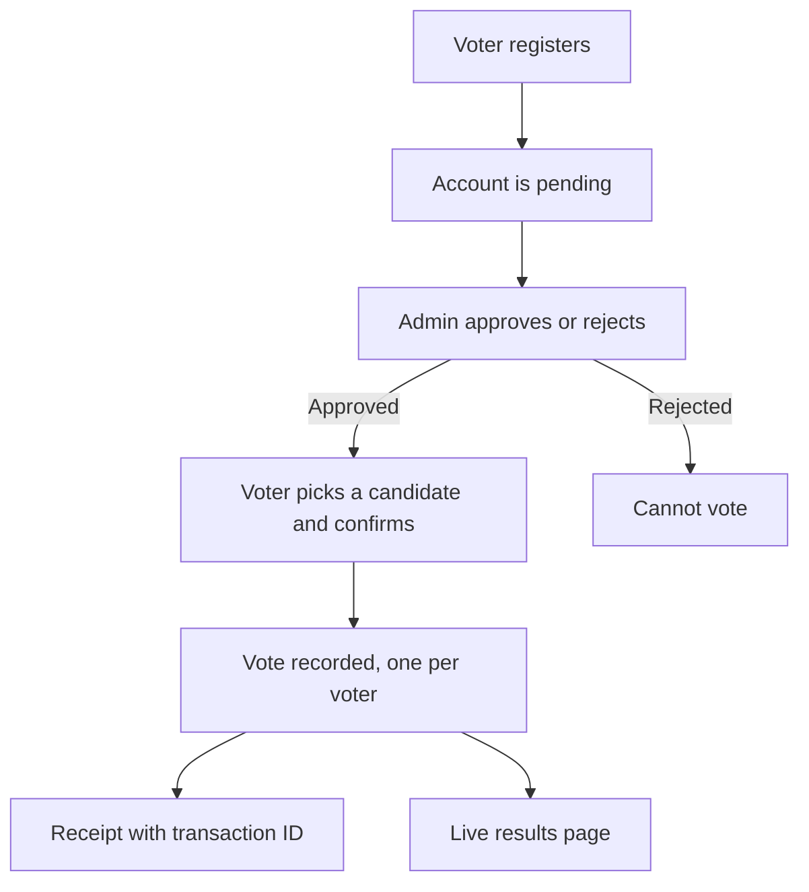

# MyVotingApp: Online Voting Portal

**A self-contained e-voting web application built with Python and Flask.**
Voters register, get approved by an admin, and cast a single vote. Admins manage candidates and voter approvals from a dashboard and can export voter data to CSV.

> **This is a showcase repository.** The source code lives in a private repository. This page documents what the project does, how it is designed, and what I learned building it. Happy to walk through the code on request.

> Demo project, not intended for real elections. All data shown is dummy sample data.

[**LinkedIn**](https://linkedin.com/in/ratnesh-pathak-087466279) | [**Email**](mailto:pathakratnesh03@gmail.com)

---

## Preview

---

## Overview

An election needs to confirm who is allowed to vote, let each person vote exactly once, and make the results visible. MyVotingApp models that whole flow in a small server-rendered web app: an admin approves voters before they can vote, each approved voter gets one vote, and results are tallied live.

## What It Does

- **Voter registration** with an admin approval step before voting is allowed
- **One vote per voter**, enforced in the application
- **Vote receipt** with a generated transaction ID
- **Live results page** with vote tallies
- **Admin dashboard** to add candidates, approve or reject voters and export a voter CSV report
- **Password reset** for voters through an identity-verification form (not available for the admin account)

## How It Works

## Security Design

- Passwords hashed with PBKDF2-SHA256, never stored in plain text
- CSRF tokens on every state-changing form
- Voting and voter approval use POST requests only, not GET links, to avoid CSRF through a simple link or image
- Secret key and admin credentials come from environment variables, with nothing hardcoded
- Session cookies are HttpOnly and SameSite=Lax, with sessions expiring after 30 minutes of inactivity
- Debug mode is off by default

## Tech Stack

- **Backend:** Python 3, Flask
- **Database:** Flask-SQLAlchemy with SQLite (swappable through a database URL setting)
- **Templating:** Jinja2, server-rendered HTML
- **Styling:** plain CSS

## Limitations (Honest Version)

- SQLite suits a demo, and a production system would need a database such as PostgreSQL or MySQL
- Password reset uses an email and date-of-birth check, which is adequate for a demo but not for a real election
- There is no rate limiting on login, registration or password reset yet
- It is a portfolio project and is not built or audited for real elections

## Roadmap

- [ ] Move to a production-grade database with connection pooling
- [ ] Rate limiting on authentication endpoints
- [ ] Automated tests for the voting and authentication flows
- [ ] Email-based password reset

## Author

**Ratnesh Pathak** - M.Sc. Information Technology, AI / ML Engineer, Founder of Team Ignites

GitHub: [@RatneshPathak](https://github.com/RatneshPathak) | LinkedIn: [Ratnesh Pathak](https://linkedin.com/in/ratnesh-pathak-087466279) | Email: pathakratnesh03@gmail.com

---

(c) Ratnesh Pathak. All rights reserved. The text and images in this repository may not be reused without permission.
